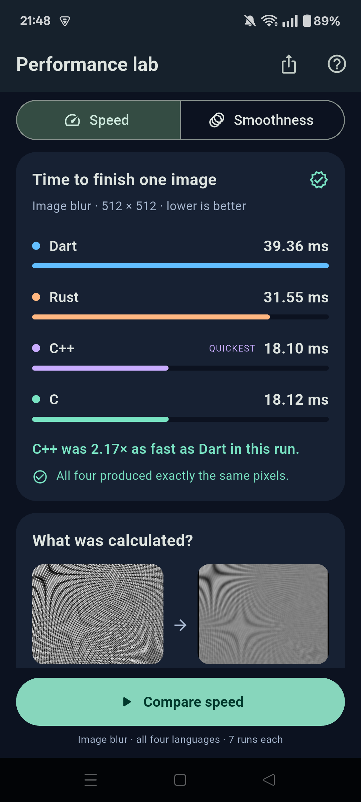
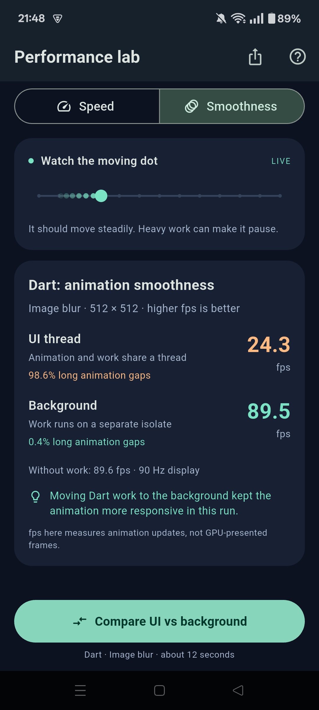

# Flutter Native Performance Lab

Compare **Dart, C, C++, and Rust** inside a Flutter app, then see what happens to an animation when that work runs on the UI isolate or a background isolate.

This is a runnable experiment with matching algorithms, exact pixel-output checks, and measurements from a real Android phone. Native code is called directly from Dart through `dart:ffi` and bundled automatically by Dart build hooks.

**The main finding:** native code reduced compute time in these workloads, while moving work off the UI isolate made the largest difference to animation responsiveness. A synchronous native call can still block Flutter's UI.

[Run the lab](#run-on-an-android-phone) · [Measured results](#results-from-a-real-phone) · [Detailed methodology](example/performance_lab/README.md) · [Hinglish video](docs/video/walkthrough-hinglish.mp4)

## See it in action

<table>
  <tr>
    <th>Speed: compare the same computation</th>
    <th>Smoothness: compare where it runs</th>
  </tr>
  <tr>
    <td></td>
    <td></td>
  </tr>
</table>

Watch the [79-second Hinglish walkthrough](docs/video/walkthrough-hinglish.mp4), or [download the MP4](https://github.com/gyanupadhyay/flutter-native-performance-lab/raw/refs/heads/main/docs/video/walkthrough-hinglish.mp4). It uses actual phone recordings and labelled result screenshots, with narrated explanations and burned-in captions. [Transcript and video notes](docs/video/README.md).

## What you can test

| Experiment | What happens | What it helps explain |
| --- | --- | --- |
| Image blur | Each engine applies the same direct 11 x 11 grayscale box filter | CPU loops, memory access, compiler optimizations, and FFI |
| Mandelbrot fractal | Each engine generates pixels using up to 400 iterations | Numerical computation and compute latency |
| UI vs background | A Flutter dot animates while the selected workload runs synchronously or in a persistent worker isolate | Why faster computation and smoother UI are separate questions |
| Original benchmark | Fibonacci, prime sieve, Mandelbrot, sorting, and repeated tiny native calls | Additional CPU examples and call-overhead costs |

**Speed** uses two warm-ups and seven measured samples per engine, checks every output byte, and reports median latency. **Smoothness** runs an idle baseline, UI-isolate work, and background-isolate work; watch the dot and compare the reported intervals. The export button copies a JSON report.

The guided lab is `example/performance_lab/main.dart`. The original three-language benchmark remains at `lib/main.dart`; running `flutter run` without `-t` opens that original app.

## Run on an Android phone

### Prerequisites

- Flutter **3.50.0 / Dart 3.14.0** were used for the recorded results. The package requires Dart `^3.14.0`.
- Android SDK, platform tools, and the NDK version selected by Flutter. Complete Android setup and resolve relevant issues reported by `flutter doctor -v`.
- Rust/Cargo with **Rust 2024 edition support** (Rust 1.85 or newer). Changing compilers can change results.
- An Android ARM64 phone with developer options and USB debugging enabled. Unlock it and authorize the debugging connection.

Install the Rust target for an ARM64 Android phone:

```sh
rustup target add aarch64-linux-android
```

For `flutter test` on your desktop, Rust also needs its host target and a compatible C/C++ toolchain: Visual Studio's Desktop development with C++ workload on Windows, or a suitable compiler and linker on Linux.

### Launch the guided lab

```sh
git clone https://github.com/gyanupadhyay/flutter-native-performance-lab.git
cd flutter-native-performance-lab
flutter pub get
flutter devices
```

Replace `DEVICE_ID` with the ID printed by `flutter devices`:

```sh
flutter run --release -d DEVICE_ID -t example/performance_lab/main.dart
```

Choose **Image blur** or **Fractal**, select a size, and tap **Compare speed**. Then open **Smoothness**, choose a language, and tap **Compare UI vs background**. Keep the app visible while measuring.

Use **release mode** for speed comparisons. Use **profile mode** when investigating Flutter frame timings with DevTools:

```sh
flutter run --profile -d DEVICE_ID -t example/performance_lab/main.dart
```

To open the original benchmark instead:

```sh
flutter run --release -d DEVICE_ID -t lib/main.dart
```

### Automated phone measurements

From PowerShell, run:

```powershell
./example/performance_lab/run-device.ps1 -Device DEVICE_ID
```

The script builds and installs a release ARM64 APK, runs both workloads and every engine/execution combination, validates outputs, and saves JSON, app logs, battery metadata, and a screenshot in the ignored `example/performance_lab/artifacts/` folder. It fails on incorrect output, missing measurements, or detected Flutter errors.

Pass `-Adb PATH` or `-Flutter PATH` if those commands are not on your PATH. Use `-SkipBuild -SkipInstall` to repeat an already installed automatic suite. To return to the interactive app, rebuild normally without `LAB_AUTO=true`, or run the script with `-Interactive`.

## Results from a real phone

Recorded **17 November 2026**, OnePlus **CPH2467**, Android **15**, ARM64, **90 Hz**, release AOT, **512 x 512** pixels. Each kernel uses one CPU thread. These results describe this device and these implementations; they are not a universal language ranking.

Median compute time in milliseconds; lower is better:

| Workload | Dart | Rust | C++ | C |
| --- | ---: | ---: | ---: | ---: |
| 11 x 11 image blur | 39.374 | 31.628 | 18.027 | 18.055 |
| Mandelbrot, 400 iterations | 150.075 | 107.902 | 108.032 | 107.971 |

For this blur implementation, C/C++ were about **2.18x as fast as Dart** (about **54% lower latency**). Rust took about **20% less time**. For Mandelbrot, all three native versions took about **28% less time** than Dart.

Animation updates per second while the blur ran; higher is better:

| Execution | Dart | Rust | C++ | C |
| --- | ---: | ---: | ---: | ---: |
| Synchronous work on UI isolate | 24.7 | 30.6 | 52.1 | 52.1 |
| Work on persistent background isolate | 89.7 | 89.9 | 89.7 | 89.8 |

The idle baseline was approximately **89.8 updates/sec**. The worker captures stayed close to it for every language.

**These are Flutter animation-ticker rates, not GPU-presented FPS or a measurement of dropped display frames.** The reports also include Flutter build/raster timing statistics, which have callback-batching limitations. The lab's CPU blur does not test GPU blur, Rive, Lottie, or native rendering.

See the [full results and qualifications](example/performance_lab/RESULTS.md), [recorded raw report](docs/results/20261117-212842-results.json), and [initial run](docs/results/20261117-212503-results.json). The video uses a separate live-tour run, so its rounded values differ slightly.

## How the comparison works

```text
Flutter UI (Dart)
  ├── UI-isolate mode: run the kernel synchronously here
  └── Worker mode: send a job to one persistent Dart isolate
        ├── Dart kernel
        ├── dart:ffi → C kernel
        ├── dart:ffi → C++ kernel
        └── dart:ffi → Rust kernel exposing a C ABI
```

- Each engine uses the same workload, dimensions, and input. C and C++ compile the same shared kernel implementation.
- Compute samples use preallocated buffers and include the kernel's FFI call cost. Input creation, allocation, correctness checks, worker startup/messaging, and preview conversion are outside that stopwatch.
- Engine order is randomized. No native kernel creates threads. Worker jobs do not overlap.
- C/C++ use `-O3` (MSVC `/O2`); Rust uses release optimization and LTO. Fast math is disabled. The build hook controls packaging and cross-compilation.
- The blur deliberately uses a straightforward algorithm. A better algorithm, vectorization, or a GPU implementation may yield a larger improvement than switching languages.

The [methodology](example/performance_lab/README.md#timing-boundaries) explains scheduling, warm-up, output checks, and timing boundaries in more detail.

## Source map

| Path | Purpose |
| --- | --- |
| [`example/performance_lab/`](example/performance_lab/) | Guided four-language lab, UI, workers, and device runner |
| [`example/performance_lab/kernels.dart`](example/performance_lab/kernels.dart) | Dart kernels, FFI declarations, buffer ownership |
| [`example/performance_lab/native/`](example/performance_lab/native/) | C, C++, and Rust lab kernels |
| [`hook/build.dart`](hook/build.dart) | Compiles and bundles native libraries automatically |
| [`rust/`](rust/) | Rust crate, release settings, and original benchmark exports |
| [`lib/`](lib/) and [`src/`](src/) | Original Dart/C++/Rust benchmark |
| [`test/`](test/) | Correctness, statistics, UI layout, and navigation regression tests |
| [`docs/`](docs/) | Curated screenshots, recorded results, and Hinglish video |

## Validation and platform support

```sh
flutter test test/performance_lab_test.dart test/performance_lab_ui_test.dart
dart analyze example/performance_lab hook/build.dart test/performance_lab_test.dart test/performance_lab_ui_test.dart
```

The lab has 15 tests covering matching native/Dart output, independently checked filter behavior and fractal points, statistics, progress, previews, small-screen/large-text layouts, result filtering, and tab/expansion navigation. The Android release lab was also exercised on the physical phone.

| Platform | Status |
| --- | --- |
| Android ARM64 | Release build and physical-device measurements validated |
| Windows | App shell/build-hook support; host correctness/UI tests exercised |
| Other Android ABIs | Rust target mapping exists; not device-validated |
| Linux | Build-hook support; app shell not included and not validated |
| iOS, macOS, Web | Not supplied by this repository |

Release APKs currently use the Android debug signing configuration for local testing. This project is a learning/benchmark app, not a store-ready application.

## Troubleshooting

- **Wrong screen:** include `-t example/performance_lab/main.dart` to open the guided lab.
- **Cargo not found / missing Rust target:** install Rust, make sure Cargo is available, and add the target named in the error. The hook also checks the standard user `.cargo/bin` location.
- **Native compiler missing in desktop tests:** install the host C/C++ toolchain; Flutter widget tests still build the native libraries.
- **Device suite times out:** unlock the phone, keep the app foregrounded, and check that the installed APK was built with `LAB_AUTO=true`. Avoid `-SkipBuild` when changing that mode.
- **Different numbers:** repeat after the phone cools down, compare the idle baseline, and keep build mode, workload, dimensions, and recording conditions consistent.

## Contributing

Include your device, OS, Flutter/Dart and native compiler versions, build mode, workload, dimensions, and raw report when sharing results. For algorithm changes, keep equivalent implementations across engines and explain any changed timing boundaries. Run the relevant tests before submitting a change.
